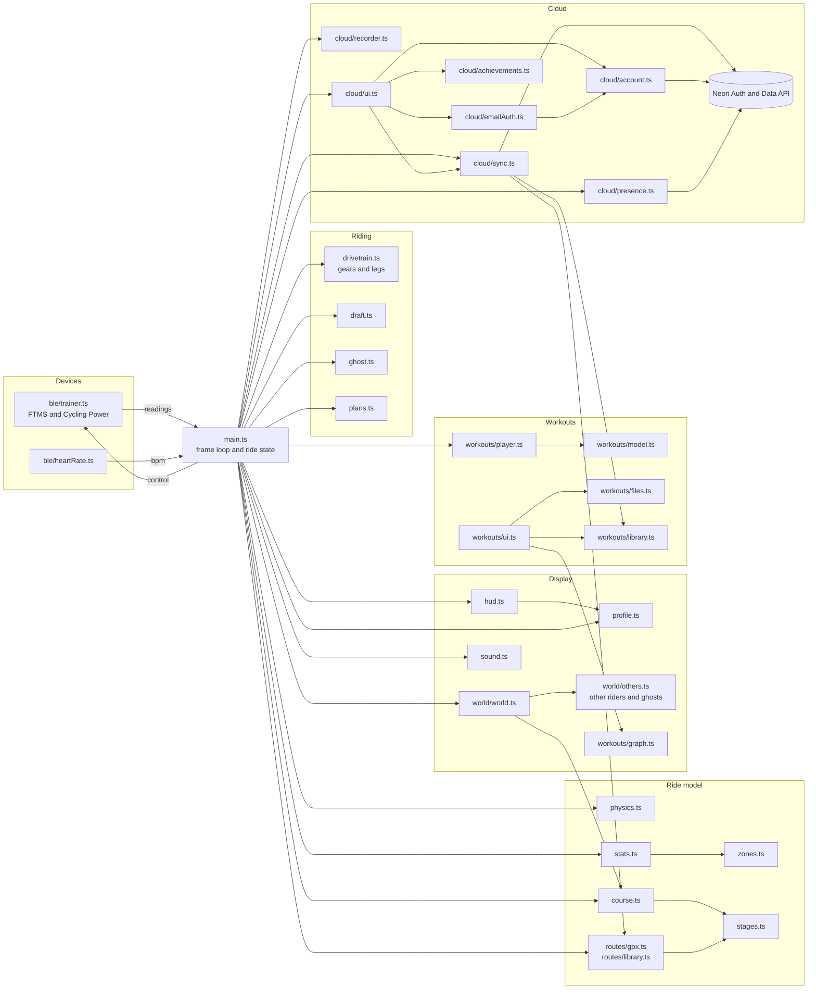

# Architecture

This page explains how the modules fit together: the frame loop, the trainer and heart-rate input, the physics and course, the HUD, the 3D world, workouts, routes, and the cloud layer, with a module diagram and the data flow between them.

## Languages and technologies

| Part | Language or format | Notes |
| --- | --- | --- |
| App code | **TypeScript** (strict), compiled to JavaScript | Everything in `src/`. `npm run build` type-checks with `tsc --noEmit`, then bundles with Vite. |
| Page markup | **HTML** | `index.html`: the home page, top bar, panels and every dialog. |
| Styles | **CSS** | `src/style.css`, plain CSS with custom properties (no preprocessor or framework). |
| Database | **SQL** (PostgreSQL, PL/pgSQL functions) | `db/schema.sql`: tables, row-level security policies and security-definer functions, run on Neon. |
| Service worker | **JavaScript** | `public/sw.js`, served as-is (not bundled). |
| App manifest | **JSON** | `public/manifest.webmanifest`. |
| Workout files | **XML** | Zwift `.zwo` import and export; `.erg` and `.mrc` are plain-text formats. Rides export as `.tcx` (XML). |
| Routes | **XML** | `.gpx` uploads. |
| 3D models | **glTF binary** (`.glb`) | `public/models/`, generated with Higgsfield. |
| Docs | **Markdown** | `docs/` and `README.md`. |

Libraries: **Three.js** (3D rendering), **@neon/neon-js** (Neon Auth and the Data API). Browser APIs: **Web Bluetooth** (trainer and heart-rate strap), **WebGL** (through Three.js), **Web Audio** (ride sounds), the **Fullscreen** and **Service Worker** APIs. Build tool: **Vite**. Hosting: **Vercel**. Backend: **Neon** (Postgres, Neon Auth, Data API). There's no server code of our own: the browser talks to Neon directly, and the database enforces who can see what.

## The shape of the app

American Flyers is a single-page app with no framework. `index.html` holds the markup, and `src/main.ts` is the entry point. It wires the modules together, owns the ride state, runs the frame loop and handles the top-bar buttons. Everything else is a module it calls.

Four things run on a timer or event, alongside the frame loop:

| Timer | Period | What it does | Where |
| --- | --- | --- | --- |
| Frame loop | Every animation frame (`requestAnimationFrame`) | Advances the ride, updates the 3D scene, and redraws the elevation strip every 200 ms. | `frame()` in `src/main.ts` |
| Trainer control | 1 second, and at once after a gear change | Sends grade (plus the virtual gear and the draft's wind factor) or ERG target power to the trainer, if they've changed. | `controlTrainer()` in `src/main.ts` |
| Riding together | 2 seconds | Sends your position and fetches the other riders on your stage. | `Presence` in `src/cloud/presence.ts` |
| Autosave | 5 minutes | Saves a long ride while signed in. | `setInterval` in `src/main.ts` |
| Settings sync | 800 ms after the last change | Writes settings to the account. | `pushSettings` in `src/cloud/sync.ts` |

Device events (trainer and heart-rate notifications) arrive as Bluetooth callbacks and are stored in a shared `live` object. The frame loop reads that object once per frame.

## Module diagram

The diagram shows the main dependencies. A few are worth knowing about:

- **`terrain.ts` and `landmarks.ts` import each other.** `terrain.ts` calls `nearLandmark()` to keep trees away from landmarks, and `landmarks.ts` calls `heightAt()` to stand models on the ground. This works because both are only called at runtime, after both modules have loaded.
- **`stages.ts` and `world/noise.ts`.** Stage definitions use the noise helpers to shape their hills, and `routes/gpx.ts` reuses the stage helpers to build routes into stages.
- **`course.ts` is the single source of truth for the road.** Physics, the HUD, the scene, the elevation strip and the trainer's grade all ask `course.ts` where the road is and how steep it is.

## The frame loop

Each frame, `frame(now)` in `src/main.ts` does this, in order:

1. Clamps the frame time to 0–0.1 s, so a tab that was in the background can't jump ahead.
2. In demo mode, sets the power from the demo slider (or from the workout target, with a small wobble). Otherwise it checks the trainer's last reading, and zeroes power and cadence after 3 seconds of silence.
3. Gets the other riders on the stage (predicted for now from their last update) and works out the draft from the rider just ahead (`draft.ts`). In a race (see [Racing and the tour](racing-and-tour.md)) it first steps the race (`race.update()`), and the pro teams are the racers; during the countdown your speed is held at zero.
4. Reads the road's grade at the rider's distance, and advances speed with `stepSpeed()` from [Physics and stats](physics-and-stats.md), with the drag area reduced by the draft.
5. Advances distance, moving time and work. It checks for the finish line, and totals climbing from the elevation at the rider's distance.
6. Updates the drivetrain (`drivetrain.ts`): the gear (automatic, or the rider's virtual gear), crank angle and bike rock, so the legs turn at a speed the wheels could produce.
7. Records one statistics sample, and one recorder sample while moving.
8. Advances the workout player, if one is running, with countdown beeps. It finishes the workout when the clock runs out.
9. Updates the sounds (wind, tyres, freewheel, crowds).
10. Passes the other riders and the ghost to the world, and calls `world.update()` to place every rider, build terrain and roads, and render.
11. Every 200 ms, updates the HUD, the status line (including the gap to the ghost), the draft gauge, and the elevation strip (or the workout graph).

The frame loop never waits on the network. Saving, syncing and loading happen in event handlers and background calls.

## State and storage

Ride state lives in module-level objects in `src/main.ts`: `live` (what the devices report), `ride` (distance, speed, climbing and so on), `stats` and `workoutStats` (see [Physics and stats](physics-and-stats.md)), and `recorder` (per-second samples for the saved ride). Starting a new ride replaces these.

Persistent state is in `localStorage`, under these keys:

| Key | Holds | Module |
| --- | --- | --- |
| `americanflyers.settings` | Settings, including data blocks | `src/settings.ts` |
| `americanflyers.workouts` | The rider's own workouts | `src/workouts/library.ts` |
| `americanflyers.routes` | The rider's uploaded GPX routes | `src/routes/library.ts` |
| `americanflyers.pendingRide` | A ride held back until sign-in | `src/main.ts` |
| `americanflyers.signedIn` | A hint that skips the home page for signed-in riders | `src/home.ts` |
| `americanflyers.onboarded` | The first-ride guide has been done or skipped | `src/onboarding.ts` |

Settings now also hold the training plan in progress, the data-block position, sound, virtual shifting, ghost and ride-together switches. The service worker keeps its own cache of the app's files (see [Project structure](project-structure.md)).

When you sign in, the account is the source of truth. The browser's copies are a working cache, so the app keeps running if the network drops. See [Backend and database](backend-and-database.md#sync-rules).

## The cloud layer

`src/cloud/` talks to Neon. `client.ts` builds the client from `@neon/neon-js`. `account.ts` holds the current user and signs in with Google or with email and password (sign-up, sign-in, password reset). `emailAuth.ts` draws the email form. `presence.ts` runs riding together. `sync.ts` reads and writes every table the browser can touch, including the admin functions. `recorder.ts` records rides and writes `.tcx` files. `achievements.ts` works out badges from rides and FTP history. `ui.ts` draws the sign-in, profile, feedback and admin dialogs, and `charts.ts` draws their charts.

Nothing in the cloud layer runs on the frame loop. Every call is triggered by a user action, a ride event, the 2-second riding-together update, or the 5-minute autosave.

## Racing

`src/raceSim.ts` is a self-contained race engine (riders in groups, attacks, breakaways, chases, sprints, classifications). `src/peloton.ts` hands the field to it in race mode, `src/race.ts` runs the countdown and the live panel's numbers, `src/raceUi.ts` draws them, and `src/tour.ts` / `src/tourUi.ts` keep the Hell of the West tour in `settings.tour`. See [Racing and the tour](racing-and-tour.md).

## Where to start reading

- To follow a ride from the trainer to the screen, read `onReading()` and `frame()` in [`src/main.ts`](../../src/main.ts), then [`src/physics.ts`](../../src/physics.ts).
- To understand the road, read [`src/course.ts`](../../src/course.ts) and [`src/stages.ts`](../../src/stages.ts).
- For the full file list, see [Project structure](project-structure.md).
